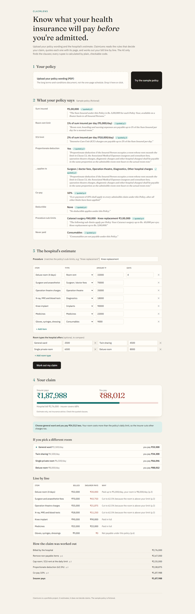

# ClaimLens

**Know what your health insurance will pay *before* you're admitted.**

Upload your policy wording (PDF) and the hospital's cost estimate. ClaimLens reads the rules
that decide your claim, quotes each one with its page number, and works out the claim line
by line: what the insurer pays, what you pay, and why, for every rupee. It also shows
what a cheaper room would save you.

**Live demo:** _deploying_ · built with FastAPI, Postgres + pgvector, Gemini / Groq, Next.js



## The problem

In India, many policies cap room rent (often 1% of the sum insured per day). Pick a
pricier room and the insurer doesn't just refuse the difference. Under a *proportionate
deduction* clause it also cuts the surgeon, theatre and test charges by the same ratio.
Families find this out at discharge.

Free claim calculators exist, but they make you type in your own policy limits and guess
how the rules apply. One says outright that it applies a room-rent deduction only
[if you confirm your policy wording supports it](https://finin2min.com/health-insurance-claim-deduction-calculator.html).
Even explainers disagree on which charges the cut applies to
([Ditto](https://joinditto.in/articles/health-insurance/proportionate-deduction-in-health-insurance/),
[SMC](https://www.smcinsurance.com/health-insurance/room-rent-limits-and-proportionate-deduction-in-health-insurance)).
The answer is in each policy's own wording. ClaimLens reads it.

In the sample (a fictional policy, a ₹2,76,000 knee replacement): a deluxe room leaves you
paying **₹88,012**. The general ward would leave you paying **₹33,500**.

## It never invents a rupee

The design rule: **the LLM finds and quotes, plain code calculates.**

1. **Read.** The PDF is split into page-aware chunks, embedded, and stored in pgvector.
   For each of nine claim rules (sum insured, room and ICU limits, proportionate
   deduction and what it touches, co-pay, deductible, procedure sub-limits, non-payable
   items) the closest passages are retrieved.
2. **Extract.** One LLM call returns every rule, with the reply shape enforced by a JSON
   schema: `found`, `page`, a word-for-word `quote`, and typed fields (enums for
   categories, numbers for money).
3. **Verify.** Each quote is searched for in the PDF text (case, whitespace, hyphenation
   and `Rs. 5,000` vs `₹5000` normalised), and the quote must itself state the value: a
   "1% of the Sum Insured" sentence can't verify "₹1 per day", and a generic sentence can't
   verify a 10% co-pay. **A rule that fails either check is discarded** and the user is
   asked to enter it. Nothing unproven reaches the maths.
4. **Calculate.** A pure-Python engine (`app/engine.py`, no I/O, `Decimal` money) applies
   the rules in order: non-payables → room/ICU caps → proportionate deduction → sub-limit
   → deductible → co-pay → sum insured. Every step and every line carries its reason and
   page.

```
policy PDF ─► pages ─► chunks + embeddings (pgvector)
                           │
     per rule: nearest passages ─► one schema-constrained LLM call
                           │
            quote found on that page? ─► typed policy terms
                                              │
hospital estimate ─────────────────► claim engine (pure Python)
                                              │
                        line-by-line result + room comparison
```

## Tested on a real policy

Beyond the bundled fictional sample, ClaimLens was run on a public 39-page insurer policy
wording (New India Mediclaim). It verified the room limit (1% of sum insured, p.9), ICU limit
(2%), the proportionate-deduction clause, and the procedure sub-limits, all with page quotes.
It resolved the clause *"all expenses except pharmacy, consumables, implants and
diagnostics"* to the right categories. It correctly reported the sum insured as not
stated, because that lives in each customer's policy schedule.

What it took to get there: telling the model the format in the prompt was not enough
on a long document, and every rule failed verification. Enforcing a JSON schema fixed it.
The Groq fallback's free tier allows 8k tokens a minute, so passages are capped at ~24k
characters, chosen round-robin so every rule keeps its best passage.

## Run it

```bash
docker compose up -d                       # Postgres 16 + pgvector on :5434
python -m venv .venv && .venv/Scripts/pip install -e ".[dev]"   # bin/ on macOS/Linux
cp .env.example .env                        # add GEMINI_API_KEY (and GROQ_API_KEY) for uploads
cd web && npm ci && npm run build && cd ..
uvicorn app.main:app --port 8011            # http://localhost:8011
pytest                                      # 79 tests
```

Without API keys the sample policy still works: its reading is cached in
`app/sample/terms.json` (regenerate with `python -m scripts.cache_sample`).

## API

| Method | Path | |
|---|---|---|
| POST | `/api/policies` | upload a policy PDF → verified terms |
| POST | `/api/policies/sample` | the fictional sample policy |
| GET | `/api/policies/{id}` | terms |
| PUT | `/api/policies/{id}/terms` | fill in terms the reader couldn't prove (stored as "entered by you", never as verified) |
| POST | `/api/simulate` | `{policy_id, estimate}` → line-by-line claim + room choices |

## Limitations

- An estimate, not insurance advice. Insurers word rules differently, and claims also depend
  on medical necessity, waiting periods and the insurer's own assessment.
- Hospital estimates are entered as line items; reading estimate PDFs isn't built yet.
- Scanned (image-only) PDFs are rejected; there's no OCR. Uploads are capped at 15 MB / 150 pages.
- Conditional rules (co-pay only above an age or in some zones) are reported as not found
  rather than guessed.

The sample policy is fictional, written for this project. No real patient data is used.
